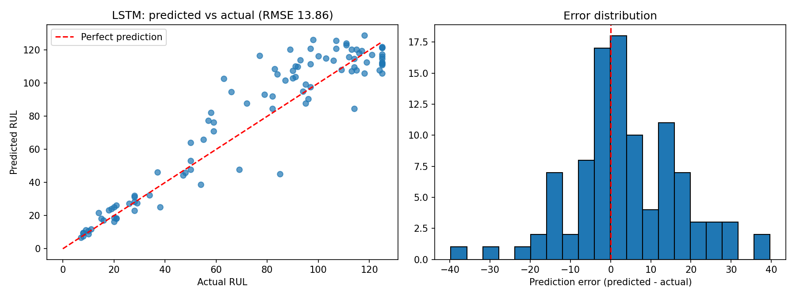
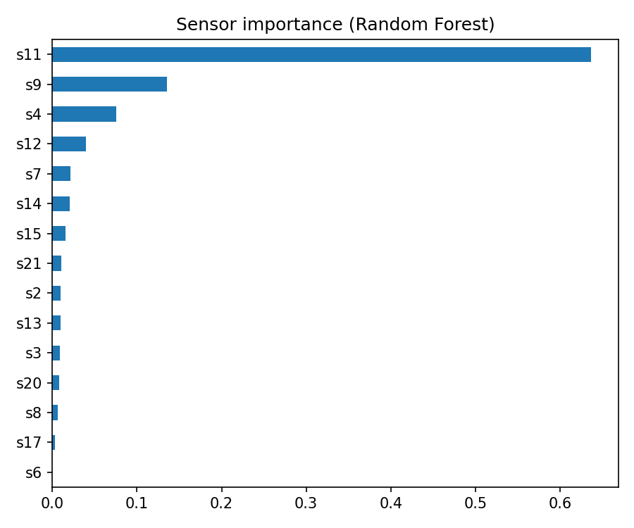
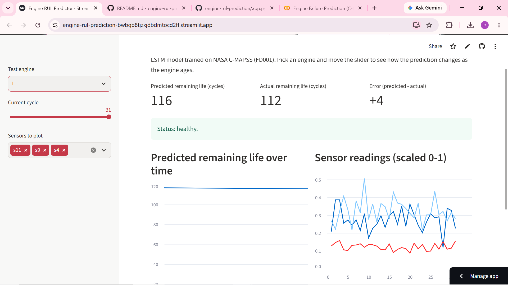

# Predictive Maintenance: Remaining Useful Life of Turbofan Engines

Predicting how many flights a jet engine has left before it fails, using NASA's C-MAPSS simulated sensor data. I compare a Random Forest baseline with an LSTM that reads the last 30 cycles of sensor readings.

## Results

| Model | Test RMSE (cycles) |
|---|---|
| Random Forest (baseline, single-row input) | 17.29 |
| **LSTM (30-cycle windows)** | **13.86** |

The LSTM reduces error by about 20% compared with the baseline.





### What the results show
- Predictions are most accurate for engines close to failure (RUL below about 40), which is the range that matters most for maintenance.
- Errors are centered on zero, so the model has no strong overall bias, and most errors fall within ±20 cycles.
- The five largest errors were all on engines with 60 or more cycles remaining. Three of them were over-predictions (the model thought the engine was healthier than it was), which is the riskier direction in practice.
- In the Random Forest, sensor `s11` is by far the most important feature, followed by `s9`, `s4`, `s12`, `s7` and `s14`. (This is from the Random Forest, not the LSTM.)

## Dataset

**NASA C-MAPSS Turbofan Engine Degradation Simulation**, subset **FD001** (one operating condition, one fault mode).

- Train: 100 engines, run until failure (20,631 rows)
- Test: 100 engines, stopped before failure (13,096 rows), with true remaining life in `RUL_FD001.txt`
- Each row: engine ID, cycle, 3 operating settings, 21 sensor readings

Download: https://data.nasa.gov/docs/legacy/CMAPSSData.zip

Citation: A. Saxena and K. Goebel (2008). "Turbofan Engine Degradation Simulation Data Set", NASA Prognostics Data Repository, NASA Ames Research Center, Moffett Field, CA.

## Method

1. **Target:** for each training row, `RUL = last cycle of the engine - current cycle`, capped at 125 (early-life degradation is not visible in the sensors).
2. **Cleaning:** removed 6 constant sensors (`s1, s5, s10, s16, s18, s19`), leaving 15 sensors.
3. **Scaling:** MinMaxScaler fitted on the training data only, then applied to the test data.
4. **Baseline:** Random Forest (100 trees, max depth 12, min leaf size 5) on single rows.
5. **LSTM:** sliding windows of the last 30 cycles; 2-layer LSTM (64 hidden units, dropout 0.2) followed by a small dense head; Adam optimizer (learning rate 1e-3), batch size 256, 30 epochs, targets divided by 125.
6. **Evaluation:** for each test engine, only its last 30 cycles are used to predict RUL. RMSE is computed against the true RUL capped at 125, the same cap as in training.

## Limitations

- Only the FD001 subset was used. FD002 to FD004 (multiple operating conditions and fault modes) are harder and not covered here.
- Hyperparameters were not tuned, and there is no separate validation set. The result comes from a single run (seed 42), so expect small variation between runs.
- The RMSE treats over- and under-prediction equally. In real maintenance, over-predicting remaining life is more dangerous than under-predicting it.

## How to run

```bash
git clone https://github.com/Chahla0/engine-rul-prediction.git
cd 
engine-rul-prediction
pip install -r requirements.txt
```

1. Download the dataset (link above) and unzip it into the project folder.
2. Open `engine_rul.ipynb` in Jupyter or Google Colab and run all cells.

## Tools

Python, pandas, NumPy, scikit-learn, PyTorch, matplotlib

## Next steps

- Extend to FD002 to FD004
- Tune the window size, model size and number of epochs
- Add a Streamlit dashboard for per-engine predictions
## Live demo

**[Open the interactive dashboard](https://engine-rul-prediction-bwbqb8tjzxjdbdmtocd2ff.streamlit.app/)**

Pick any of the 100 test engines, move the slider through its life, and watch the predicted remaining useful life and the sensor readings update.


